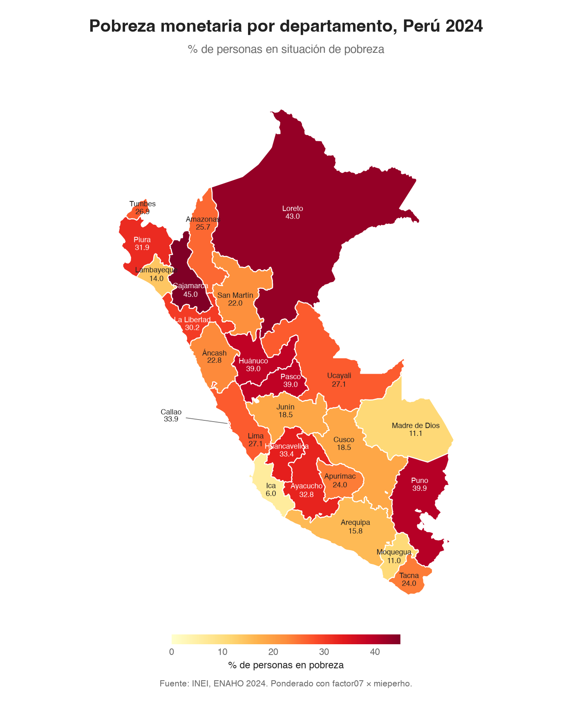

# enaho-skills

Tres skills de Claude Code que limpian, grafican y mapean la ENAHO 2024 del INEI. Basta clonar el repositorio y pedirle a Claude «un mapa de la pobreza por departamento»: Claude usa las skills y replica la pobreza oficial.

Proyecto de la sesión 16 del curso [Data-Science-Python](https://github.com/d2cml-ai/Data-Science-Python/tree/main/sessions/16-skills-enaho).



## Las skills

| Skill | Entra | Sale |
|---|---|---|
| [`limpiando-enaho`](.claude/skills/limpiando-enaho/SKILL.md) | Los zip de los módulos 34 (sumaria) y 02 (miembros) | `salidas/personas_2024.parquet`, `salidas/hogares_2024.parquet` y `salidas/validacion.txt` |
| [`graficando-enaho`](.claude/skills/graficando-enaho/SKILL.md) | La base limpia y un corte: área, sexo o edad | `figuras/pobreza_<corte>_2024.png` |
| [`mapeando-enaho`](.claude/skills/mapeando-enaho/SKILL.md) | La base de hogares y el GeoJSON de departamentos | `mapas/pobreza_departamento.png` |

Si falta la base limpia, las skills de gráficos y mapas llaman primero a `limpiando-enaho`. Así un solo pedido activa dos skills seguidas.

## 1. Preparar

Necesitas [uv](https://docs.astral.sh/uv/) y [Claude Code](https://code.claude.com).

```bash
git clone https://github.com/ximenapize/enaho-skills.git
cd enaho-skills
uv sync
```

## 2. Bajar los datos

Los datos no se suben al repositorio: van en `datos/`, que está en `.gitignore`. `966` es el código de la ENAHO 2024 en el portal de microdatos del INEI.

```bash
mkdir -p datos
curl -L -o datos/966-Modulo34.zip https://proyectos.inei.gob.pe/iinei/srienaho/descarga/STATA/966-Modulo34.zip
curl -L -o datos/966-Modulo02.zip https://proyectos.inei.gob.pe/iinei/srienaho/descarga/STATA/966-Modulo02.zip
curl -L -o datos/peru_departamental_simple.geojson https://raw.githubusercontent.com/d2cml-ai/Data-Science-Python/main/sessions/06-geoespacial/lab/Data/peru_departamental_simple.geojson
```

## 3. Correr

**Con Claude Code.** Abre `claude` en la carpeta y pide, por ejemplo:

- «¿Cuál fue la pobreza en Cusco en 2024?»
- «Grafica la pobreza urbana y rural»
- «Haz un mapa de la pobreza por departamento con la ENAHO 2024»

También puedes llamar una skill a mano: `/graficando-enaho sexo` o `/mapeando-enaho 2024`.

**Sin Claude, solo los scripts:**

```bash
uv run .claude/skills/limpiando-enaho/scripts/limpiar.py --anio 2024
uv run .claude/skills/graficando-enaho/scripts/graficar.py --por area   # o sexo, edad
uv run .claude/skills/mapeando-enaho/scripts/mapear.py
```

## Validación

[`salidas/validacion.txt`](salidas/validacion.txt):

| Cifra | Valor | INEI |
|---|---|---|
| Residentes habituales | 108,664 de 117,721 | 108,664 |
| Pobreza (hogares, `factor07 × mieperho`) | 27.58 % | 27.6 % |
| Pobreza (personas, `facpob07`) | 27.53 % | 27.6 % |
| Urbano / rural | 24.8 % / 39.3 % | 24.8 % / 39.3 % |
| Departamentos | 25 con dato, diferencia de 0.00 puntos con la tabla del INEI | — |

Las cifras por área y por departamento se calculan por hogar con `factor07 × mieperho`, como el INEI. Con `facpob07` por persona, algunos departamentos se desvían hasta 0.5 puntos. El detalle está en [`reference.md`](.claude/skills/limpiando-enaho/reference.md).

## Estilo de las figuras

Tipografía Helvetica, texto centrado, bordes blancos en el mapa y un color por temática: pobreza de amarillo a rojo, agua en azul, saneamiento en celeste, ambiente en verde. Los scripts aceptan `--tema` para usar la paleta de otro tema.

## Evaluación

Hicimos tres pedidos con y sin skills. Los resultados están en [`evaluacion.md`](evaluacion.md). En resumen: sin skills, Opus no respondió la pregunta de Cusco y sus figuras no cumplían las reglas. Con skills, todo salió bien y en dos pedidos se activaron dos skills seguidas.

## Estructura

```text
.claude/skills/
  limpiando-enaho/   SKILL.md, reference.md, scripts/limpiar.py
  graficando-enaho/  SKILL.md, scripts/graficar.py
  mapeando-enaho/    SKILL.md, scripts/mapear.py
referencias/         pobreza departamental 2024 del INEI, para validar el mapa
salidas/validacion.txt
figuras/  mapas/
evaluacion.md  evaluar.sh  evaluar_sin.sh
README.md  pyproject.toml  uv.lock
```
